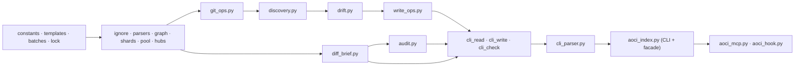

<a id="top"></a>

<div align="center">


<h1>AOCI Codebase Fast Index</h1>

<p>
  <b>AI-Oriented Codebase Indexing for coding agents</b><br>
  <sub>One read pass &rarr; repository-wide architecture, cross-file dependencies &amp; non-obvious invariants</sub>
</p>

<p>
  <a href="./pyproject.toml"></a>
  <a href="https://github.com/dreamforSh/AOCI-index/actions/workflows/ci.yml"></a>
  
  
  
</p>
<p>
  
  
  <a href="./LICENSE"></a>
</p>

<p>
  <a href="#index-format"><b>Format</b></a>&nbsp;&nbsp;&middot;&nbsp;&nbsp;
  <a href="#key-features"><b>Features</b></a>&nbsp;&nbsp;&middot;&nbsp;&nbsp;
  <a href="#quick-start"><b>Quick Start</b></a>&nbsp;&nbsp;&middot;&nbsp;&nbsp;
  <a href="#installation"><b>Install</b></a>&nbsp;&nbsp;&middot;&nbsp;&nbsp;
  <a href="#workspace-layout"><b>Layout</b></a>&nbsp;&nbsp;&middot;&nbsp;&nbsp;
  <a href="#cli--mcp-reference"><b>Reference</b></a>&nbsp;&nbsp;&middot;&nbsp;&nbsp;
  <a href="#documentation--testing"><b>Docs</b></a>
</p>

</div>

---

**`aoci-index`** is a zero-dependency Python 3.8+ **AI-Oriented Codebase Indexing** (`.aoci/`) engine — combining a BM25/FRAS graph reader, multi-host lifecycle guardrails, and a stdio MCP `2025-06-18` server for **Claude Code**, **Antigravity**, **Codex**, **Cursor**, **Windsurf**, and **VS Code / GitHub Copilot**.

A single read pass gives coding agents repository-wide architectural orientation, cross-file dependencies, and non-obvious invariants — while keeping `.aoci/` strictly local via `.git/info/exclude`.

<table>
  <tr>
    <td width="25%" align="center"><b>Zero Dependencies</b><br><sub>Python 3.8+ stdlib only</sub></td>
    <td width="25%" align="center"><b>Local-Only <code>.aoci/</code></b><br><sub>Excluded via <code>.git/info/exclude</code></sub></td>
    <td width="25%" align="center"><b>Sub-Second Sync</b><br><sub>LF SHA-256, <code>sig_hash</code> &amp; Hub WAL pool</sub></td>
    <td width="25%" align="center"><b>27 MCP Tools</b><br><sub>Warm in-memory stdio server</sub></td>
  </tr>
</table>

##  Index Format

Each managed repository stores dense architectural records across `.aoci/aoci.txt`, `.aoci/aoci.code.txt`, and optional `.aoci/aoci.hubs.txt`:

```text
# aoci.txt (Root Manifest)
#Global-Invariants: All write HTTP endpoints require JWT auth middleware; monetary values use int64 cents

# aoci.code.txt (object-fras-v2 — one dense line per managed file)
src/auth/jwt.py[MA8M]: F:Issues and verifies JWT access tokens with multi-KID key rotation | R:src/config/env.py | A:issue_token/verify_token<-src/routes/orders.py | S:Enforce explicit alg allowlist rejecting none; clock_skew fixed at 30s; keep previous KID active >=24h
src/order/service.py[AO9M]: F:Orchestrates idempotent order creation and stock reservation | R:src/config/env.py,src/order/repo.py | A:create_order/cancel_order<-src/routes/orders.py | S:Unique idempotency_key for retries; never invoke synchronous HTTP inside a DB transaction

# aoci.hubs.txt (Optional H-tier symbol zoom spans)
src/order/service.py#create_order[L42-L118]: F:Validates cents payload, reserves inventory row-locked, and records order atomically | S:Must hold SELECT FOR UPDATE before payment intent creation
```

| Part | Token | Meaning |
| :--- | :---: | :--- |
| **Coordinate `[LDIS]`** | **`L`** | Layer — `E A D K P I M U C R T O` |
| **Coordinate `[LDIS]`** | **`D`** | Domain — `[A-Z0-9]` |
| **Coordinate `[LDIS]`** | **`I`** | Importance — `1`–`9` |
| **Coordinate `[LDIS]`** | **`S`** | Size tier — `T / S / M / L / H`, auto-verified from line count |
| **FRAS Field** | **`F:`** | Responsibility |
| **FRAS Field** | **`R:`** | Read-along dependencies |
| **FRAS Field** | **`A:`** | Exports &amp; `<-callers` |
| **FRAS Field** | **`S:`** | Non-obvious stability, ordering, or security traps |

##  Key Features

<table>
  <tr>
    <td width="50%" valign="top">
      <p> <b>Index &amp; Symbol Map</b></p>
      <ul>
        <li><b>Single-Pass Codebase Map (<code>object-fras-v2</code>)</b> — Dense one-line-per-file map in <code>.aoci/aoci.code.txt</code>, paired with <code>#Global-Invariants:</code> (<code>aoci.txt</code>), <code>[LDIS]</code> tags and bilingual <code>#Glossary:</code> aliases (<code>aoci.meta.txt</code>), plus auto-synced directory shards (<code>shard</code>) for 10k+ file monorepos.</li>
        <li><b>H-Tier Symbol Zoom (<code>aoci.hubs.txt</code>)</b> — <code>zoom</code> / <code>aoci_zoom</code> extracts and verifies <code>[Lstart-Lend]</code> spans for large (<code>&gt;= 1000</code>-line) hub files, auto-registering <code>hubs</code> in <code>aoci.txt</code>, refreshing/pruning spans during <code>upsert</code>, migrating renames, surfacing <code>hub_sections</code> in read calls, and checking spans in <code>verify</code>/<code>lint</code>.</li>
        <li><b>Cross-File Symbol Lookup</b> — <code>symbol</code> / <code>aoci_symbol</code> searches across <code>aoci.hubs.txt</code>, cached/live outlines, and FRAS <code>A:</code> exports, returning spans, signatures, and graph callers/dependencies.</li>
      </ul>
    </td>
    <td width="50%" valign="top">
      <p> <b>Context Packing &amp; Test Impact</b></p>
      <ul>
        <li><b>Task-Driven Context Packing</b> — <code>pack</code> / <code>aoci_pack</code> builds token-budgeted packets from BM25, bilingual glossary expansion, explicit path mentions (<code>PathMentionIndex</code>), L1.5 hub sections, and working-tree Git diffs.</li>
        <li><b>Impacted Test Derivation</b> — <code>--with-tests</code> on <code>context</code>, <code>diff</code>, and <code>pack</code> (plus <code>--tests-for</code> / <code>tests_for</code> on <code>query</code>) attaches impacted T-layer tests via FRAS graph hops, warm static imports, and multi-language naming conventions; <code>--live-test-imports</code> inspects uncached tests in memory.</li>
        <li><b>Cold-Cache Live Anchors</b> — <code>--live-anchors</code> extracts symbol anchors when the outline cache is cold without writing to disk.</li>
      </ul>
    </td>
  </tr>
  <tr>
    <td width="50%" valign="top">
      <p> <b>Sub-Second Drift &amp; Sync</b></p>
      <ul>
        <li><b>Drift &amp; Rich <code>sig_hash</code></b> — LF-normalized SHA-256 + <code>(mtime, size)</code> baseline (<code>baseline.json</code>, schema v2) classifies edits as <code>impl_only</code> vs <code>contract_changed</code> across Python, JS/TS/Vue/Svelte, Go, Rust, JVM/C#, C/C++, and Proto/GraphQL/Prisma/SQL.</li>
        <li><b>Rename &amp; Hub-Aware Branch Restore</b> — Exact and MinHash moved+edited rename migration (<code>migrate-renames</code>), plus zero-token <code>restore</code> of both file FRAS entries and line-shift-resilient L1.5 <code>aoci.hubs.txt</code> symbol entries from a cross-worktree SQLite WAL semantic pool (<code>&lt;git-common-dir&gt;/aoci-cache</code>).</li>
        <li><b>Single-Pass &amp; Parallel Subagent Sync</b> — <code>prepare-sync</code> + <code>apply-sync</code> run ordered one-lock pipelines, while <code>batch-pack</code> / <code>aoci_batch_pack</code> and <code>upsert --pending-dir</code> enable parallel subagent batch fan-out and atomic merge.</li>
      </ul>
    </td>
    <td width="50%" valign="top">
      <p> <b>MCP, CI Guard &amp; 6-Host Setup</b></p>
      <ul>
        <li><b>Modern MCP <code>2025-06-18</code> Server</b> — <code>aoci_mcp.py</code> serves <b>27 annotated tools</b> (with <code>outputSchema</code> &amp; <code>structuredContent</code>), <code>roots/list</code> multi-root discovery, <code>resources/subscribe</code> live update notifications, <b>5 static resources</b>, <b>2 URI templates</b>, and <b>3 prompts</b>.</li>
        <li><b>CI Guard &amp; Diff-Colored Graph Export</b> — <code>ci-check</code> / <code>aoci_ci_check</code> (plus root <code>action.yml</code>) checks layer rules, Tarjan cycles, and PR diff test impact even in zero-index CI runners, emitting SARIF 2.1.0, GitHub annotations, or PR Markdown; <code>export --format html --diff</code> highlights changed and affected nodes.</li>
        <li><b>6-Host Installer &amp; Guardrails</b> — One-command setup and surgical uninstall for <b>Claude Code</b>, <b>Antigravity</b>, <b>Codex</b>, <b>Cursor</b>, <b>Windsurf</b>, and <b>VS Code / Copilot</b>, keeping <code>.aoci/</code> excluded via <code>.git/info/exclude</code>.</li>
      </ul>
    </td>
  </tr>
</table>

##  Quick Start

```bash
# 1. Initialize .aoci/ and enforce local Git exclusion
python scripts/aoci_index.py init --root <repo>

# 2. Scan for unindexed files and scaffold a line-balanced batch (batch_01.txt)
python scripts/aoci_index.py scan --root <repo> --batch-size 20
python scripts/aoci_index.py scaffold --root <repo> --batch 1 --output .aoci/pending/batch_01.txt

# 3. After reading the source files and filling <TODO> F:/S: fields, merge the batch
python scripts/aoci_index.py upsert --root <repo> --entries-file .aoci/pending/batch_01.txt

# 4. Pack task-scoped context, preview diff + test impact, and verify index health
python scripts/aoci_index.py pack --root <repo> --task "Fix JWT rotation skew" --budget 2500
python scripts/aoci_index.py diff --root <repo> --with-tests
python scripts/aoci_index.py verify --root <repo> && python scripts/aoci_index.py lint --root <repo>

# Zero-token dogfooding bootstrap on AOCI-index itself:
python scripts/aoci_index.py init --root . && python scripts/aoci_index.py pool import --root . --input examples/self-pool.json.gz && python scripts/aoci_index.py restore --root .
```

##  Installation

### Claude Code

```bash
# Global install (skill + lifecycle hooks + optional MCP server & CLAUDE.md snippet)
python scripts/install.py --host claude-code --scope global --with-hooks --with-mcp

# Project-scoped install
python scripts/install.py --host claude-code --scope project --project-root <repo> --with-hooks --with-rules --with-mcp
```

### Antigravity

```bash
# Global Antigravity plugin bundle (skill + plugin.json + hooks + rules + MCP)
python scripts/install.py --host antigravity --scope global --as-plugin --with-hooks --with-rules --with-mcp
```

### Codex

```bash
# Global install (~/.agents/skills/ + ~/.codex/hooks.json + ~/.codex/config.toml)
python scripts/install.py --host codex --scope global --with-hooks --with-mcp

# Project-scoped install (.agents/skills/ + .codex/hooks.json + AGENTS.md + .codex/config.toml)
python scripts/install.py --host codex --scope project --project-root <repo> --with-hooks --with-rules --with-mcp

### Cursor, Windsurf & VS Code Copilot

```bash
# Cursor (.cursor/skills + .cursor/rules/aoci-index.mdc + .cursor/hooks.json + .cursor/mcp.json)
python scripts/install.py --host cursor --scope project --project-root <repo> --with-hooks --with-rules --with-mcp

# Windsurf & VS Code Copilot (project: .vscode/mcp.json `servers` + .github/copilot-instructions.md;
#   global: VS Code user dir `Code/User/mcp.json` — %APPDATA% / ~/Library/Application Support / ~/.config)
python scripts/install.py --host windsurf --scope global --with-rules --with-mcp
python scripts/install.py --host vscode --scope project --project-root <repo> --with-rules --with-mcp

# Install across all 6 supported hosts at once (`claude-code`, `antigravity`, `codex`, `cursor`, `windsurf`, `vscode`)
python scripts/install.py --host all --scope global --with-hooks --with-mcp
```

### Optional Editable CLI Package & AST Extra

```bash
pip install -e .                  # zero runtime dependencies
pip install -e ".[treesitter]"    # optional tree-sitter AST accelerator
aoci-index --version              # aoci-index 1.5.0
aoci-mcp                          # launches the stdio MCP server
aoci-hook --help                  # multi-host lifecycle hook runner
aoci-install --help               # cross-host skill/hook/MCP installer
```

> [!TIP]
> See [references/hooks-and-install.md](./references/hooks-and-install.md) for manual setup, `--keep-config`, and hook contract verification.

##  Workspace Layout

```text
<repo>/.aoci/
├── aoci.txt             # Root manifest: #Project, #Global-Invariants, volume layout, #Read-Order
├── aoci.meta.txt        # Meta volume: [LDIS] tag dictionary, bilingual #Glossary, FRAS rules
├── aoci.code.txt        # Code volume: object-fras-v2 dense single-line map
├── aoci.hubs.txt        # Optional H-tier symbol sub-volume (`zoom`)
├── baseline.json        # Compact LF-normalized SHA-256, sig_hash, sketch & (mtime, size) baseline
├── .aociignore          # Optional extra ignore globs (full .gitignore syntax)
├── shards/              # Optional per-directory `.code.txt` slices & `INDEX.txt` (`shard`)
├── pending/             # Scratch directory for batch entry files (never indexed or committed)
├── .sessions/           # Hook-managed per-session drift snapshots
└── .cache/              # Git exclusion, Git discovery, outline, scan_fps & batch_plan caches
```

> [!NOTE]
> `.aoci/` is excluded locally via `.git/info/exclude` (never modifying tracked `.gitignore`), keeping repository history and teammate checkouts untouched.

### Engine Module Graph (`scripts/`)



##  CLI & MCP Reference

### Read, Search & Context

| Action | CLI (`python scripts/aoci_index.py ...`) | MCP Tool (`scripts/aoci_mcp.py`) |
| :--- | :--- | :--- |
| Digest & core hubs | `overview --root <repo>` | `aoci_overview` |
| Search / impact / tests | `query --root <repo> --search "<terms>"` / `--tests-for <path>` | `aoci_query` (`tests_for`, `live_test_imports`) |
| Cross-file symbol lookup | `symbol <name> --root <repo> [--exact] [--live]` | `aoci_symbol` |
| Dependency subgraph | `context <path> --root <repo> --depth 1 [--with-tests]` | `aoci_context` (`with_tests`) |
| Task-driven context pack | `pack --task "<description>" --root <repo> [--budget 2500] [--with-tests] [--live-anchors]` | `aoci_pack` |
| Diff impact briefing | `diff [rev] --root <repo> [--with-tests]` | `aoci_diff` (`with_tests`) |
| Static outline | `outline <paths...> --root <repo>` | `aoci_outline` |
| Graph export (Mermaid/DOT/HTML) | `export --root <repo> --format mermaid\|dot\|html [--diff]` | `aoci_export` (`diff`, `diff_rev`, `output`) |

### Initialize, Build & Sync

| Action | CLI (`python scripts/aoci_index.py ...`) | MCP Tool (`scripts/aoci_mcp.py`) |
| :--- | :--- | :--- |
| Initialize `.aoci/` | `init --root <repo>` | `aoci_init` |
| Drift & batch plan | `scan` / `status --root <repo> --batch-size 20` | `aoci_scan` |
| Single-pass sync briefing | `prepare-sync --root <repo> [--max-diff-lines 40]` | `aoci_prepare_sync` |
| One-shot ordered sync | `apply-sync --root <repo> [--restore] [--migrate-renames] [--pending-dir <dir>] ...` | `aoci_apply_sync` (`pending_dir`, `clean_pending`) |
| Subagent batch work-pack | `batch-pack --root <repo> --batch 1 [--with-source]` | `aoci_batch_pack` |
| Pre-filled batch scaffold | `scaffold --root <repo> --batch 1` | `aoci_scaffold` |
| H-tier symbol sub-volume | `zoom <path> --root <repo>` / `--scaffold` / `--upsert` | `aoci_zoom` |
| Merge FRAS entries | `upsert --root <repo> --entries-file <file>` / `--pending-dir <dir>` | `aoci_upsert` (`pending_dir`, `clean_pending`) |
| Acknowledge clean edits | `ack <paths...> --root <repo>` | `aoci_ack` |
| Rename migration | `migrate-renames --root <repo>` | `aoci_migrate_renames` |
| Branch / worktree restore | `restore --root <repo>` | `aoci_restore` |

### Verify, Audit, CI Guard & Setup

| Action | CLI (`python scripts/aoci_index.py ...`) | MCP Tool (`scripts/aoci_mcp.py`) |
| :--- | :--- | :--- |
| Full health gate | `verify --root <repo>` | `aoci_verify` |
| FRAS quality lint | `lint --root <repo> [--limit 100]` | `aoci_lint` (`limit`) |
| Architecture & cycle audit | `audit --root <repo> [--co-change [--exclude-tests]]` | `aoci_audit` (`exclude_tests`) |
| CI guard (SARIF/GitHub/PR) | `ci-check --root <repo> [--base-rev <rev>] [--format sarif\|github\|markdown] [--markdown-output <file>]` | `aoci_ci_check` (`sarif_output`, `markdown_output`) |
| Per-directory shards | `shard --root <repo> [--depth 1 \| --clean]` | `aoci_shard` |
| Semantic pool cache | `pool stats\|export\|import --root <repo>` | `aoci_pool` |
| Repair Git exclusion | `ensure-git-exclude --root <repo>` | `aoci_ensure_git_exclude` |
| Local Git hooks | `install-git-hooks --root <repo> [--with-pre-commit]` | `aoci_install_git_hooks` |

### MCP Surface

Speaks MCP JSON-RPC 2.0 over stdio (`2024-11-05` · `2025-03-26` · `2025-06-18`) with automatic newline-delimited JSON or `Content-Length` framing:

| Surface | Entries |
| :--- | :--- |
| **Resources (5)** | `aoci://manifest` · `aoci://meta` · `aoci://code` · `aoci://hubs` · `aoci://shards/INDEX` |
| **URI Templates (2)** | `aoci://shards/{shard}` · `aoci://{volume}?root={root}` |
| **Prompts (3)** | `aoci-bootstrap` · `aoci-review-diff` · `aoci-sync` |

##  Documentation & Testing

| Topic | Link |
| :--- | :--- |
| Skill protocol & workflows | [SKILL.md](./SKILL.md) |
| Format spec & scaling architecture | [references/aoci-format-spec.md](./references/aoci-format-spec.md) |
| Installation & lifecycle hook contracts | [references/hooks-and-install.md](./references/hooks-and-install.md) |
| Worked index examples | [examples/](./examples/) |

```bash
# Run with base Python on PATH (stdlib unittest only, requires git)
python -B tests/test_aoci.py
python -B -m unittest discover -s tests -p "test_*.py"

# After modifying scripts/ (or other pooled files), refresh examples/self-pool.json.gz:
python -B .github/scripts/refresh_self_pool.py
python -B .github/scripts/refresh_self_pool.py --check
```

---

<div align="center">
  
  <br>
  <sub>Zero dependencies &middot; Local-only <code>.aoci/</code> &middot; Built for Claude Code, Antigravity &amp; Codex &middot; <a href="./LICENSE">MIT License</a></sub>
  <br>
  <sub><a href="#top">Back to top</a></sub>
</div>
